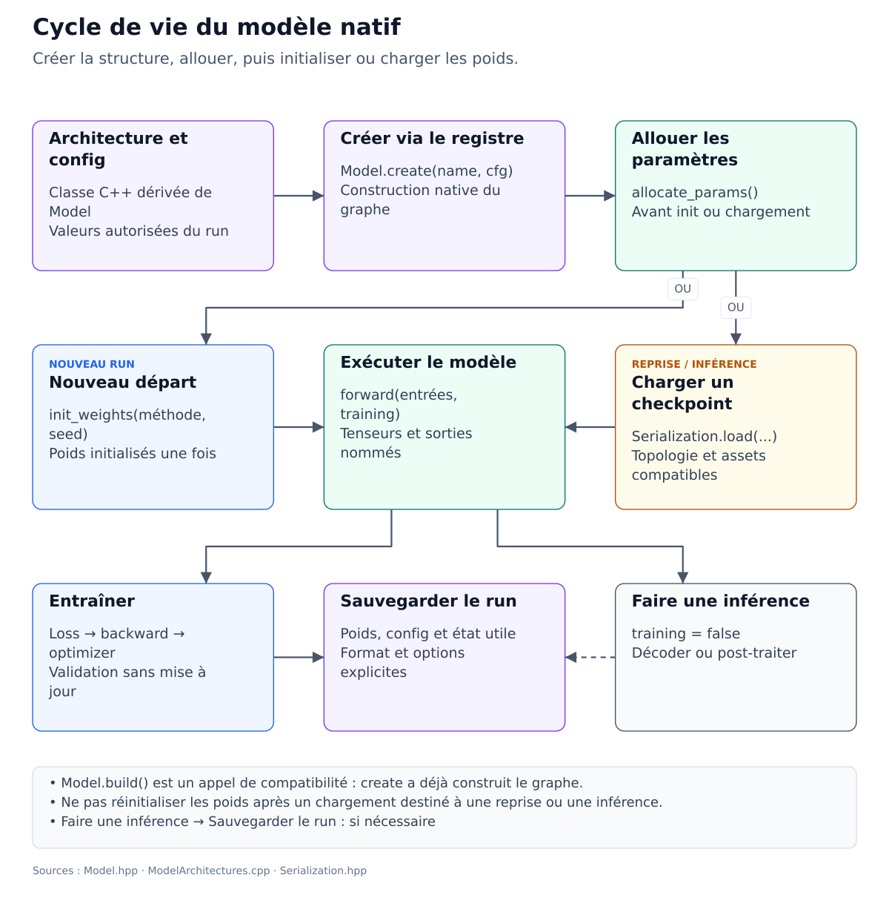

# Cycle de vie d’un modèle

Suivre le bon ordre d'appels pour éviter les erreurs courantes.

**Public concerné :** Débutant à intermédiaire.

> **Prérequis**
>
> Savoir lancer un script Lua.

## Sur cette page

- [Diagramme d'explication](#diagramme-dexplication)
- [Vue d'ensemble (ordre recommandé - Moderne)](#vue-densemble-ordre-recommandé---moderne)
- [1) Récupérer une config (et la surcharger)](#1-récupérer-une-config-et-la-surcharger)
- [2) Create (structure + construction automatique)](#2-create-structure-construction-automatique)
- [Types de layers gérés (table rapide)](#types-de-layers-gérés-table-rapide)
- [3) Allouer les paramètres (poids)](#3-allouer-les-paramètres-poids)
- [4) Initialiser OU charger un checkpoint](#4-initialiser-ou-charger-un-checkpoint)
- [5) Forward (inputs)](#5-forward-inputs)
- [6) Backward / optimizer (niveau bas)](#6-backward-optimizer-niveau-bas)
- [Étapes suivantes](#étapes-suivantes)

## Diagramme d'explication




Cette page explique **l’ordre des appels** et surtout **pourquoi** cet ordre existe.

Cet ordre distingue les erreurs de configuration, d’allocation et de chargement.

## Vue d'ensemble (ordre recommandé - Moderne)

**Workflow simplifié (v3.0+):** depuis la v3.0, `Model.create()` construit automatiquement le réseau — pas besoin d'appeler `build()` séparément.

| Étape | Appel | Ce que ça fait | Quand |
| ---: | --- | --- | --- |
| 1 | `Model.create(name, cfg)` | récupère config, construit le réseau via registry | toujours |
| 2 | `Model.allocate_params()` | alloue les poids en mémoire | avant init/load |
| 3a | `Model.init_weights(method, seed)` | init aléatoire | entraînement from scratch |
| 3b | `Serialization.load(path)` | charge les poids depuis checkpoint | reprise/inférence |
| 4 | `Model.forward(input, training)` | exécute le forward pass | entraînement/inférence |

> **Note :** `Model.build()` existe toujours pour compatibilité avec les scripts legacy, mais c'est maintenant un **no-op** — le réseau est déjà construit à l'étape 1 par `create()`.

## 1) Récupérer une config (et la surcharger)

```lua
local cfg, err = Mimir.Architectures.default_config("transformer")
assert(cfg, err)

cfg.seq_len = 128
cfg.vocab_size = 8000
cfg.dtype = "float16" -- optionnel: dtype du modèle et des exports compatibles
```

Conseil : évite de fabriquer une config “from scratch” : vous risquez d’oublier des champs attendus.

## 2) Create (structure + construction automatique)

```lua
local ok, err = Mimir.Model.create("transformer", cfg)
assert(ok, err)

-- Le réseau est maintenant construit et prêt pour allocation/init
```

Important : `create()` lance automatiquement la construction du réseau **via le registre C++**. Vous n'avez PAS besoin d'appeler `build()` séparément (il y a seulement un no-op pour rétrocompatibilité).

## Types de layers gérés (table rapide)

Le runtime exécute une liste de `Layer` (C++) dont le champ `type` est normalisé via `LayerRegistry::normalize_type` (ex: `Relu` → `ReLU`, `ConvTranspose` → `ConvTranspose2d`).

Cette table liste les types **les plus fréquents**. Pour la liste complète (avec alias), voir:

- [docs/03-API-Reference/01-Layers.md](../03-API-Reference/01-Layers.md)
- `src/LayerTypes.hpp`

| Type (canonique) | Catégorie | Rôle (résumé) | Champs/config typiques |
| --- | --- | --- | --- |
| `Conv2d` | Conv | Convolution 2D (vision / U-Net / feature extractor). | `in_channels`, `out_channels`, `kernel_size` (ou `kernel_h/kernel_w`), `stride`, `padding`, `dilation`, `groups` |
| `ConvTranspose2d` | Conv | Convolution transposée 2D (upsampling). | idem `Conv2d` |
| `Linear` | Dense | Projection dense (GEMM). | `in_features`, `out_features`, `use_bias` |
| `Embedding` | NLP | IDs int → vecteurs (chemin “int path”). | `vocab_size`, `embed_dim`, `padding_idx` |
| `LayerNorm` | Norm | Normalisation sur la dernière dimension (Transformer). | `eps` |
| `GroupNorm` | Norm | Normalisation groupée (vision). | `num_groups`, `eps` |
| `RMSNorm` | Norm | Variante de LayerNorm (RMS-only). | `eps` |
| `ReLU` | Activation | Non-linéarité ReLU. | — |
| `GELU` | Activation | Activation GELU (Transformer). | — |
| `SiLU` | Activation | SiLU/Swish (vision/diffusion). | — |
| `Softmax` | Activation | Softmax (souvent sur logits). | `axis` |
| `LogSoftmax` | Activation | Log-Softmax (souvent pour NLL). | `axis` |
| `Dropout` | Reg | Dropout (entraînement). | `dropout_p` |
| `Add` | Elemwise | Addition élément-par-élément (résiduel). | multi-input via `inputs`, `output` |
| `MatMul` | Tensor op | Matmul (produit matriciel). | dépend des shapes |
| `Concat` | Tensor op | Concaténation le long d’un axe. | `concat_axis` |
| `Reshape` / `View` | Shape | Refaçonne les dimensions sans changer le contenu. | `target_shape` |
| `SelfAttention` | Attention | Self-attention (expérimental/couteux selon build). | `seq_len`, `num_heads`, `head_dim`, `causal` |
| `MultiHeadAttention` | Attention | Variante multi-têtes. | idem |
| `CrossAttention` | Attention | Attention query↔context (diffusion/encoder-decoder). | idem |
| `TokenMeanPool` | Pooling | Moyenne sur tokens (résumé séquence). | `axis` (selon implémentation) |
| `Identity` | Special | No-op (debug / placeholder). | — |
| `PatchEmbed` | Custom | Projection learnable de patches (vision/diffusion). | `patch_dim`, `num_patches`, etc. |

### Opérations complémentaires et couverture

Les couches `Conv3d`, `Conv4d`, `CausalDepthwiseConv1d`, `SwiGLU`, `GEGLU`
et `SquaredReLU` sont aussi déclarées dans `src/LayerTypes.hpp`. La
[référence des layers](../03-API-Reference/01-Layers.md) centralise la liste,
les alias et les contrats pour éviter de dupliquer ici un inventaire incomplet.

Un type déclaré ne garantit pas un kernel natif et un backward sur chaque
backend. La disponibilité dépend du routeur, des capacités du runtime et du
build ; consultez les diagnostics de dispatch et les tests du backend choisi.

## 3) Allouer les paramètres (poids)

```lua
local ok, total_or_err = Mimir.Model.allocate_params()
assert(ok ~= false, total_or_err)
```

Pourquoi c’est séparé : vous pouvez construire la structure et choisir ensuite comment/si vous allouez (utile pour debug / estimation mémoire).

## 4) Initialiser OU charger un checkpoint

### Option A : init from scratch

```lua
assert(Mimir.Model.init_weights("xavier", 42))
```

### Option B : charger

```lua
local ok, err = Mimir.Serialization.load("checkpoint/my_model.safetensors")
assert(ok ~= false, err)
```

Note dtype : si le checkpoint embarque `model_config.dtype`, il est réappliqué automatiquement au modèle au load. C’est utile si vous voulez reprendre un run puis réécrire un checkpoint sans changer la politique de stockage des tenseurs float.

Exemple de reprise minimal :

```lua
local cfg, err = Mimir.Architectures.default_config("transformer")
assert(cfg, err)

assert(Mimir.Model.create("transformer", cfg))
-- Model.build() n'est plus nécessaire (v3.0+: network construit automatiquement)
assert(Mimir.Model.allocate_params())

local ok, load_err = Mimir.Serialization.load("checkpoint/my_model.safetensors")
assert(ok ~= false, load_err)

local ids = {}
for i = 1, cfg.seq_len do ids[i] = 1 end
local neutral = {}
for i = 1, cfg.d_model do neutral[i] = 0.0 end
local out = Mimir.Model.forward({__input__ = ids, mag = neutral, mod = neutral}, false)
assert(out)
```

Dans cet exemple Transformer, `mag` et `mod` sont des vecteurs flottants de
`d_model` composantes, diffusés sur les tokens. Les zéros rendent ces ajouts
neutres ; un workflow qui fournit un `ConditioningEncoder` peut les composer
automatiquement. Leur absence dans un appel direct peut produire
`Missing input tensor: mag`.

Conseil : la config doit matcher (ex: `seq_len`, `vocab_size`, dims). Sinon vous aurez un mismatch de shapes.

## 5) Forward (inputs)

Extrait schématique : fournissez une table map et respectez la longueur et
le type attendus par l’architecture :

```lua
local out = Mimir.Model.forward({ __input__ = {1,1,1,1} }, false)
assert(out)
```

Pourquoi : ça rend les scripts compatibles multi-input (ex: texte+image) sans refactor.

## 6) Backward / optimizer (niveau bas)

Si vous construisez votre boucle à la main :

- `Mimir.Model.zero_grads()`
- `Mimir.Model.forward(...)`
- construire `grad_out` (gradient par rapport à la sortie)
- `Mimir.Model.backward(grad_out)`
- `Mimir.Model.optimizer_step(learning_rate, optimizer?)`

Note : selon les layers, tous les backward ne sont pas au même niveau de maturité (donc commence par des tests unitaires courts).

## Étapes suivantes

- [Page précédente : Concepts essentiels](01-Core-Concepts.md)
- [Index de la documentation](../00-INDEX.md)
- [Page suivante : Données / datasets](03-Data.md)
