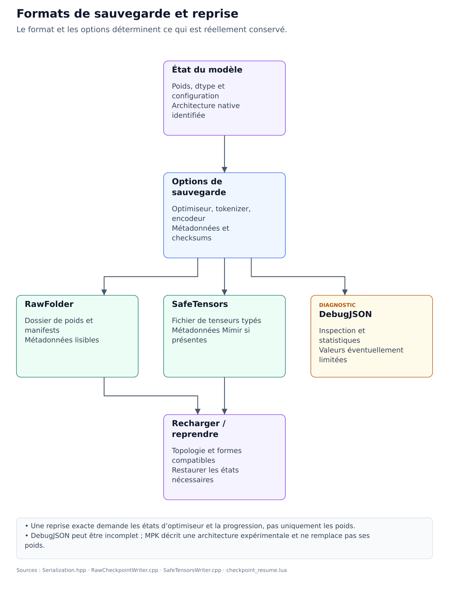
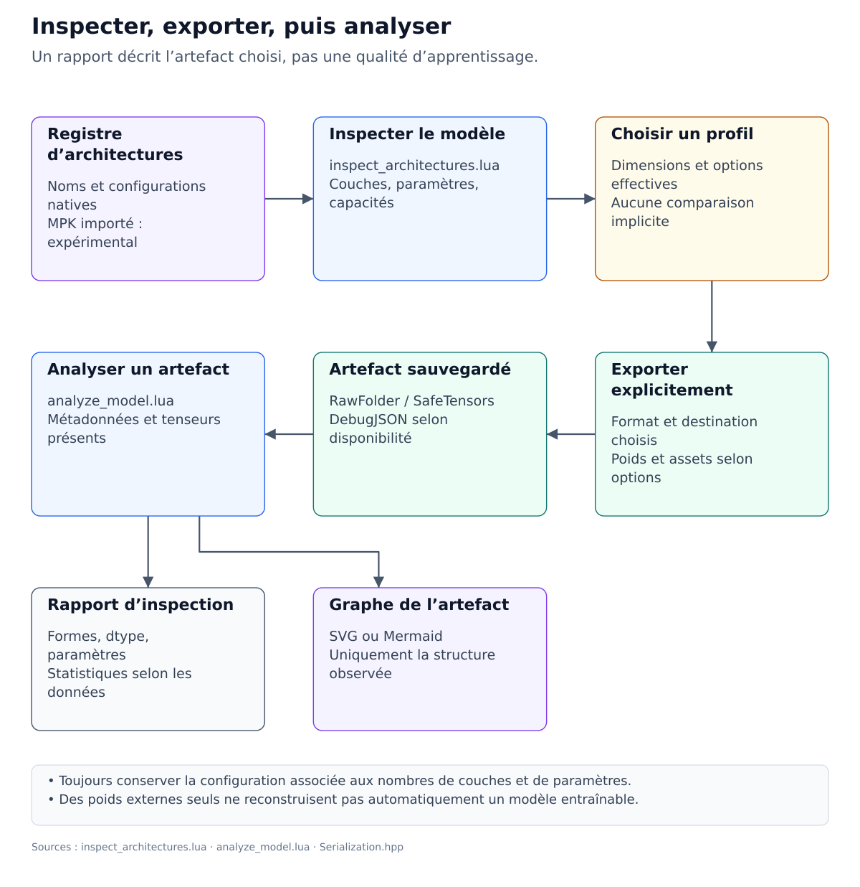
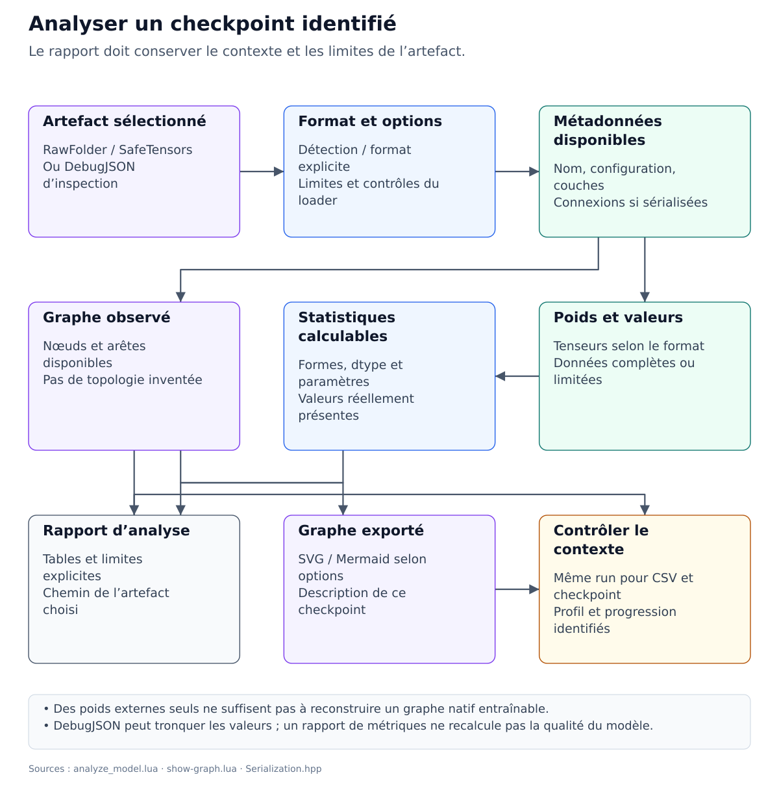

# Checkpoints et reprise d’entraînement

Sauvegarder, charger et reprendre sans perdre d'état utile.

**Public concerné :** Débutant à intermédiaire.

> **Prérequis**
>
> Avoir un modèle en mémoire (créé ou entraîné).

## Diagrammes d'explication








## Deux APIs existent

- `Mimir.Serialization.*` : API “moderne” (recommandée)
- `Mimir.Checkpoint.*` : legacy (dépréciée, alias)

## Sauvegarder

```lua
local ok, err = Mimir.Serialization.save("checkpoint/run1", "raw_folder", {
  save_optimizer = true,
  save_tokenizer = true,
  save_encoder = true,
  include_checksums = true,
  include_git_info = true,
})
assert(ok, err)
```

Note dtype : le dtype de stockage (f16/bf16/f32/f64) est contrôlé par `cfg.dtype` (recommandé) ou par `Mimir.Model.dtype("...")`. Lors d’un `load()`, si le checkpoint contient `model_config.dtype`, il est réappliqué au runtime.

Formats disponibles :

- `safetensors`
- `raw_folder`
- `debug_json`

## Charger

Auto-détection :

```lua
local ok, err = Mimir.Serialization.load("checkpoint/run1")
assert(ok, err)
```

Options utiles :

- `strict_mode` : rend les mismatches de shapes/clefs plus stricts.
- `validate_checksums` : vérifie les SHA256 si présents.

## Reprise (resume)

Bon pattern :

- garder un dossier fixe `out_dir`
- écrire dans des sous-dossiers `_interrupt_*` en cas de Ctrl+C
- reprendre via `scripts/modules/checkpoint_resume.lua`

`checkpoint_resume.lua` sélectionne un candidat RawFolder. Il prend d'abord
le sous-dossier `epoch_*` au numéro le plus élevé, puis le compare aux dossiers
`step_*` ou `step-*` triés numériquement, au sous-dossier `final` et à la racine.
Quand `model/training.json` expose `step` ou `loop.global_step`, la comparaison
retient la progression la plus élevée parmi ces candidats. À progression
égale ou absente, un candidat parcouru plus tard remplace le précédent :
`final`, puis la racine, peuvent donc remplacer une sauvegarde périodique.

La reconnaissance porte sur la présence d'un fichier d'architecture ou de poids
à un emplacement attendu ; elle ne vérifie pas l'intégrité de tous les fichiers.
Le chargement effectif et les contrôles du script restent nécessaires pour
établir qu'une reprise est valide. Le résolveur ne recherche pas une architecture
compatible à votre place.

Les scripts d'entraînement qui sauvegardent un résultat final utilisent
généralement `<out-dir>/final`. Passer ce dossier directement à un loader ou au
script d'inférence évite toute ambiguïté ; le résolveur est destiné à la reprise
depuis le dossier de run.

VAEText : voir `scripts/training/train_vae_texte.lua`.

## Étapes suivantes

- [Page précédente : Tokenizer & ConditioningEncoder](07-Tokenizer-Encoder.md)
- [Index de la documentation](../00-INDEX.md)
- [Page suivante : Mode `--conf`: Config-Driven Scripting](08-Config-Driven-Scripting.md)
