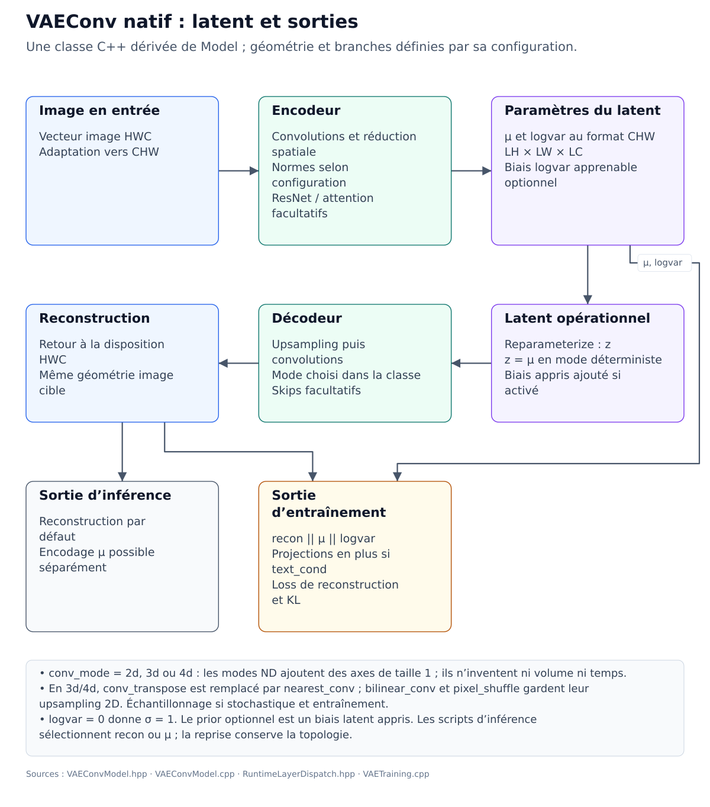
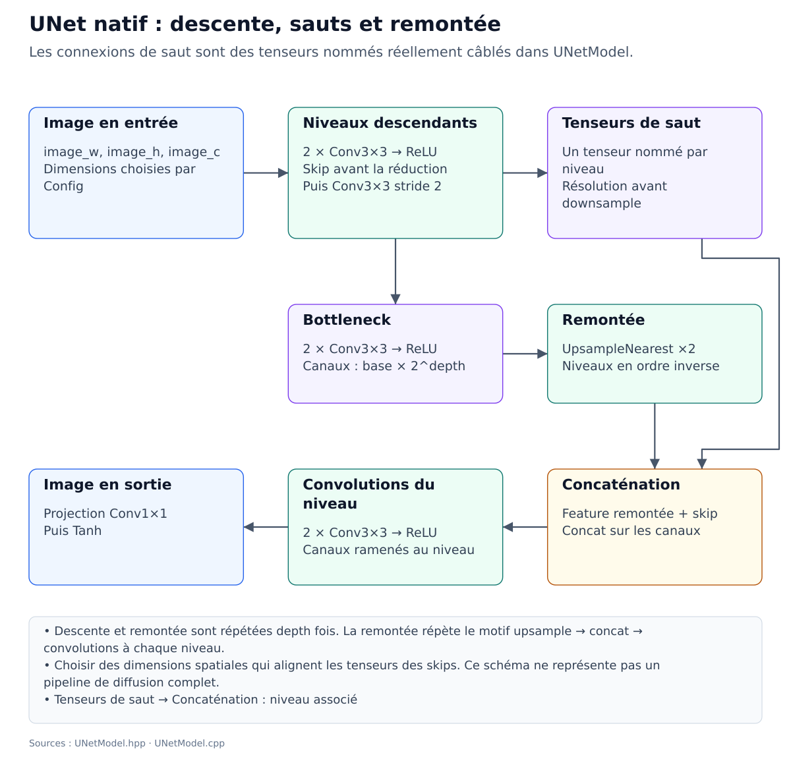
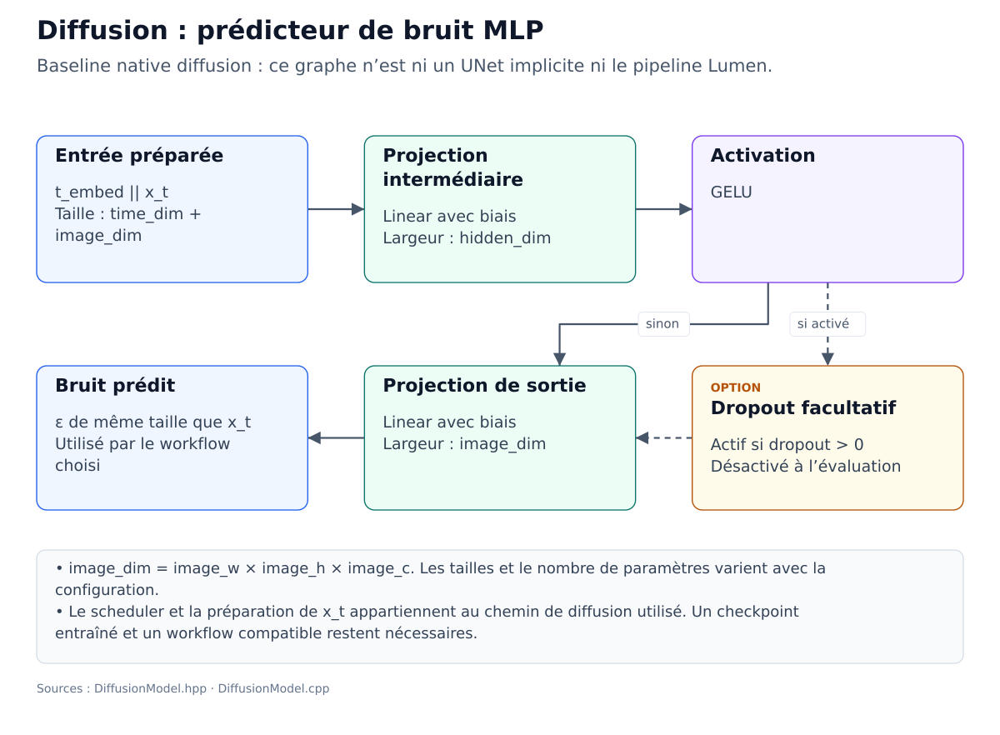
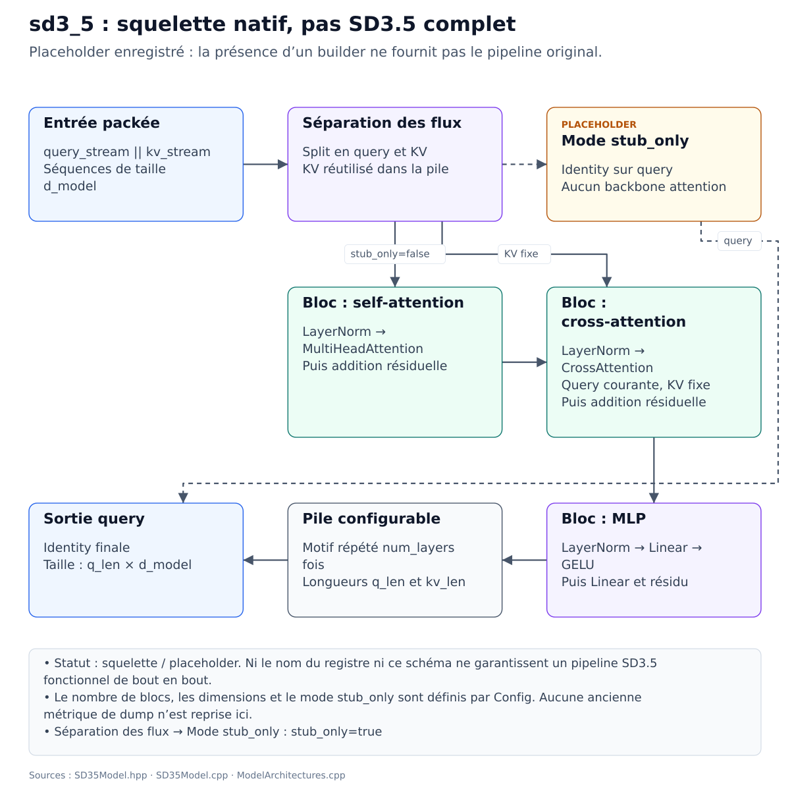

# Diffusion : SD3.5 et autoencodeurs

Comprendre et exécuter les chemins diffusion disponibles.

**Public concerné :** Intermédiaire guidé.

> **Prérequis**
>
> Checkpoints/config adaptés au modèle choisi.

## Diagrammes d'explication









Les images suivent les classes du dépôt. `DiffusionModel` est une baseline MLP,
tandis que le schéma UNet décrit sa propre classe ; ces deux images ne forment
pas implicitement un pipeline Lumen. Les blocs VAEConv sont configurables et
`sd3_5` reste un placeholder. Les schémas ne fixent pas un nombre de paramètres
indépendant de la configuration. Voir leur [provenance](../graphs/README.md).

Ce dépôt contient des architectures diffusion/autoencoder exposées via le registre.

Voir aussi:

- Exemples: `10-Examples.md`
- Datasets (linking par basename): `03-Data.md`
- Checkpoints: `08-Checkpoints.md`

## SD3.5 (skeleton / démos)

- Architecture : `sd3_5` (alias: `SD3.5`)
- Statut : squelette/placeholder enregistré, sans script de démonstration dédié dans
  le dépôt courant.

Inspection :

```bash
./bin/mimir --lua scripts/tools/inspect_architectures.lua -- \
  --list sd3_5 --params --layers
```

## Autoencoder image

- VAE conv : `vae_conv` (vision)
- Script training : `scripts/training/train_vae_conv.lua`

Astuce: commence par un VAE conv petit et valide le save/load avant d’attaquer une pipeline diffusion complète.

## Lumen : régler la génération avant de lancer

`scripts/inferences/lumen_text2img.lua` utilise un checkpoint Lumen natif et son
VAEConv entraîné. Il vérifie la géométrie et la calibration VAE enregistrées, et
charge le tokenizer du checkpoint par défaut. Avec une interface Viz utilisable,
il attend une action **Générer** après édition du prompt, de la seed, du nombre
d’étapes, de la guidance et du chemin PPM. Les valeurs de la ligne de commande
servent de réglages initiaux.

Exemple à adapter à un checkpoint existant (ce chemin d’exemple n’est pas une
fixture de test fournie avec le dépôt) :

```bash
./run_mimir.sh --lua scripts/inferences/lumen_text2img.lua -- \
  --checkpoint checkpoint/lumen --prompt "un paysage" \
  --seed 1337 --steps 30 --guidance 5 --out outputs/lumen.ppm
```

Le panneau reste disponible après la génération pour modifier les réglages et
relancer. Fermer le panneau avant de générer annule l’opération. Ajouter
`--headless` ou `--no-viz` pour générer et enregistrer une seule fois sans
attendre une interaction. Sans backend ou affichage utilisable, ce mode en ligne
de commande est également conservé automatiquement. Voir les
[contrôles Viz de Lumen](../03-API-Reference/15-Viz-Htop.md#préparer-une-inférence-lumen-dans-viz).

Le conditionnement texte peut utiliser le Transformer interne, un checkpoint
VAEText ou un encodeur T5 natif. Consultez le guide
[VAEText](11-VAEText.md#conditionnement-textuel-de-lumen) ou le guide
[T5 pour Lumen](16-T5.md#conditionnement-de-lumen) pour les options
d'entraînement et de reprise. Le conditionnement VAEText et T5 sont
mutuellement exclusifs.

## Statut

Le registre distingue le squelette `sd3_5`, la baseline MLP `diffusion` et
le modèle natif de diffusion latente `lumen_diffusion`. L'absence de checkpoint entraîné
ne transforme pas ces implémentations en un même type de démo.
Lumen utilise son DiT, un VAEConv compatible et un scheduler ; un UNet séparé
n'est pas requis par ce chemin.

Le script d'entraînement Lumen choisit `vae_text` par défaut pour un nouveau
run et exige alors un checkpoint VAEText compatible. Pour entraîner avec son
encodeur Transformer interne, passez explicitement
`--text-conditioning transformer`. Le choix `t5` exige son checkpoint T5.
Une reprise conserve le mode sauvegardé.

Pour juger la cohérence des images générées, il faut :

- un VAE image entraîné
- le modèle de diffusion correspondant entraîné
- une config de scheduler cohérente
- une évaluation sur les prompts et images du domaine visé

## Étapes suivantes

- [Page précédente : Tutoriel : Transformer causal (GPT-style)](12-Transformer-GPT.md)
- [Index de la documentation](../00-INDEX.md)
- [Page suivante : VAEConv : architecture, configuration et entraînement](14-VAEConv.md)
