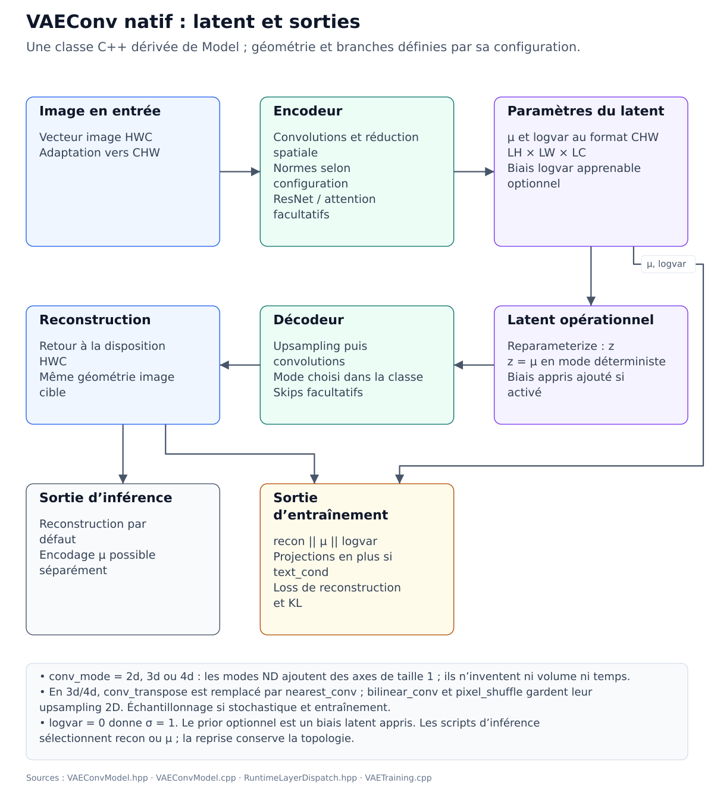

# VAEConv : architecture, configuration et entraînement

Comprendre le graphe réel de `vae_conv`, choisir une configuration cohérente et éviter les erreurs de dimensions ou de contrat latent.

**Public concerné :** Utilisateur qui veut construire, entraîner, inspecter ou réutiliser le VAE convolutionnel de Mímir.

> **Prérequis**
>
> Avoir compilé Mímir et connaître le cycle `create → allocate_params → init_weights ou load`.

## Sur cette page

- [Sources de vérité](#sources-de-vérité)
- [1. Graphe réel](#1-graphe-réel)
- [2. Réparamétrisation et mode déterministe](#2-réparamétrisation-et-mode-déterministe)
- [3. Le prior appris](#3-le-prior-appris)
- [4. Contraintes de formes](#4-contraintes-de-formes)
- [5. Paramètres importants](#5-paramètres-importants)
- [6. Exemple : inspecter la configuration sans dataset](#6-exemple-inspecter-la-configuration-sans-dataset)
- [7. Exemple : décoder un latent](#7-exemple-décoder-un-latent)
- [8. Entraîner avec le script officiel](#8-entraîner-avec-le-script-officiel)
- [9. Vérifications après modification](#9-vérifications-après-modification)
- [10. Diagnostic rapide](#10-diagnostic-rapide)
- [Étapes suivantes](#étapes-suivantes)

## Sources de vérité

- configuration publique : `src/Models/Vision/VAEConvModel.hpp`;
- construction du graphe : `src/Models/Vision/VAEConvModel.cpp`;
- configuration du registre : `src/Models/Registry/ModelArchitectures.cpp`;
- loss VAE et backward : `src/Models/VAETraining.cpp`, via le contrat natif du modèle ;
- boucle Lua haut niveau : `src/scriptings/Lua/luaScripting/LuaScriptingModelAndRegistry.cpp`;
- script fourni : `scripts/training/train_vae_conv.lua`.

## 1. Graphe réel



Le schéma suit la classe C++ et ses options. Il distingue la reconstruction
d’inférence de la sortie d’entraînement et ne fixe pas le nombre de couches
ou de paramètres. Les modes ND ajoutent des axes de taille 1 à cette entrée
image ; ils ne créent pas une vidéo ou un volume à partir de l’image.

Pour une image `H × W × C` et un latent `LH × LW × LC` :

```text
image HWC
  → Reshape/Permute vers CHW
  → Conv2d C→base
  → [ResBlock et SelfAttention optionnels]
  → N convolutions stride 2
  → Conv2d 1×1 vers mu     (LC×LH×LW)
  → branche logvar : Conv2d 3×3 → SiLU → normalisation encodeur
  → Conv2d 1×1 vers logvar (LC×LH×LW)
  → Reparameterize : z = mu + exp(0.5×logvar)×epsilon
  → Add(z, z_prior_bias) si use_encoder_prior=true
  → Conv2d LC→base
  → N upsamplings
  → Conv2d base→C
  → Tanh
  → Permute vers HWC
```

Pendant l’entraînement, la sortie principale `x` est un vecteur concaténé :

```text
reconstruction[image_dim] || mu[latent_dim] || logvar[latent_dim]
```

Si `text_cond=true`, deux projections sont ajoutées :

```text
... || img_proj[proj_dim] || txt_proj[proj_dim]
```

Par défaut, en inférence (`training=false`), le forward s’arrête à `vae_conv/recon` et retourne directement la reconstruction de taille `image_dim`. Les projections multimodales et `vae_conv/out_concat` ne sont ni exécutées ni matérialisées. La configuration `inference_output_tensor` permet de sélectionner une autre sortie existante du graphe ; le script d’encodage utilise `vae_conv/mu` pour retourner uniquement la moyenne latente.

Le latent opérationnel `z` sert au décodeur. Il n’est pas placé dans la zone `mu` de la sortie : la loss KL doit être calculée sur les paramètres de la distribution, pas sur un échantillon.

La branche `logvar` possède son propre préconditionnement spatial à la résolution latente. La normalisation suit `enc_norm` (`GroupNorm`, `LayerNorm` ou aucune si `enc_norm=none`) avant la projection linéaire `1×1`. Cette topologie ajoute des paramètres et requiert donc un checkpoint compatible.

### Biais de la tête de variance

`logvar_head_bias=true` rend la dernière convolution `1×1` de `logvar` affine :
elle apprend un biais par canal latent, partagé sur ses positions spatiales.
La tête peut ainsi ajuster un niveau d’incertitude indépendamment des features
qui lui arrivent, y compris lorsque celles-ci sont centrées ou nulles.
La tête `mu` conserve sa construction d’origine.

Le défaut du constructeur C++ et du registre est `false`, afin de conserver
les anciens blocs de poids. Le script `train_vae_conv.lua` et la configuration
officielle activent ce biais pour les nouveaux entraînements. Le script accepte
`--logvar-head-bias true|false` et l’alias `--logvar_head_bias`.

En reprise, le script conserve le champ `use_bias` de la couche sauvegardée
`vae_conv/enc/logvar`, ou `logvar_head_bias` si cette métadonnée de couche est
absente. Sans ces deux informations, il conserve `false`. Une surcharge CLI
incompatible est refusée. Activer ce biais sur un modèle qui en était dépourvu
demande un nouveau dossier et `--resume false`, car la taille du bloc de poids
change. Cette capacité affine ne suffit pas à garantir la qualité du posterior
ou de la reconstruction sur un corpus donné.

### Modes de convolution 2D, 3D et 4D

`conv_mode` choisit les couches de convolution du graphe complet et du décodeur autonome. Le défaut `2d` conserve le chemin historique. Le script d’entraînement expose `--conv-mode 2d|3d|4d` ; les alias CLI `2`, `3`, `4`, `conv2d`, `conv3d` et `conv4d` sont normalisés.

| Mode | Forme spatiale interne d’un canal | Noyau spatial |
| --- | --- | --- |
| `2d` | `H × W` | `k × k` |
| `3d` | `1 × H × W` | `1 × k × k` |
| `4d` | `1 × 1 × H × W` | `1 × 1 × k × k` |

Les images d’entrée et de sortie restent en HWC ; les cartes et latents restent des buffers CHW aplatis. Les axes supplémentaires sont toujours de taille 1 : ces modes ne créent ni volume, ni séquence vidéo, ni mélange temporel. La taille du latent et son format RAW ne changent pas. Les couches `Conv3d` et `Conv4d` passent par le routeur et les dispatchers natifs du runtime disponible.

Il n’y a pas de convolution transposée ND dans ce chemin. En `3d` ou `4d`, `decoder_upsample=conv_transpose` est résolu en `nearest_conv` : upsampling image 2D, puis convolution du rang demandé. La configuration effective `nearest_conv` est affichée et sauvegardée. `bilinear_conv` et `pixel_shuffle` conservent leurs opérations de réarrangement/upsampling 2D et utilisent les convolutions sélectionnées autour de celles-ci.

Le passage en ND ne garantit aucun gain de vitesse ou de qualité. Il change le type d’opération et le chemin d’exécution ; les arrondis et le coût peuvent différer selon le runtime. Pour comparer les modes, employer notamment le même upsampling effectif.

### Contexte latent et détails sous-pixel

Deux branches optionnelles complètent ce graphe, sans modifier les dimensions de `mu`, `logvar` et `z` :

| Paramètre | Défaut du registre | Effet |
| --- | --- | --- |
| `latent_spatial_context` | `false` | Projections résiduelles et trois convolutions de dilatation 1, 2 et 4 à la résolution latente, avant les têtes statistiques et à l’entrée du décodeur. |
| `latent_context_channels` | `32` | Largeur de ces features et de la projection des détails, indépendante de `base_channels` ; minimum 2. |
| `latent_detail_path` | `false` | Regroupement des positions sous-pixel de l’image en canaux, puis projection et fusion avant `mu/logvar`. Le décodeur prédit depuis `z` un résidu par position sous-pixel, réarrangé vers l’image et ajouté avant `Tanh`. |

Le chemin de détails ne fournit aucune image ni feature de l’encodeur directement au décodeur : tout passe par la distribution latente. Les coordonnées relatives des pixels d’un bloc sont conservées par `Reshape/Permute`, y compris pour les images rectangulaires RGB. Le contexte élargit le champ réceptif sans réduire la grille ; cette approche suit le principe des [convolutions dilatées pour agréger le contexte](https://arxiv.org/abs/1511.07122). Elle n’active pas la SelfAttention globale.

Avec un petit `base_channels`, cette branche évite de comprimer tous les détails dans les seuls canaux de la voie principale du décodeur. Elle ajoute toutefois des paramètres et du calcul : `latent_context_channels` permet d’ajuster son coût. L’amélioration sur un dataset réel doit être évaluée après entraînement ; augmenter la capacité ne garantit pas à lui seul une meilleure reconstruction.

`configs/vae_conv-config.json` active les deux branches avec une largeur de 32 pour les **nouveaux entraînements**. Les défauts du registre restent désactivés pour la compatibilité. En reprise, le script conserve les trois paramètres du checkpoint, ou les branches désactivées pour un checkpoint legacy ; une surcharge CLI incompatible est refusée. Le décodeur seul et l’import d’un VAE dans Lumen réutilisent ces paramètres.

Pour entraîner la nouvelle topologie dans un dossier distinct :

```bash
./bin/mimir --conf configs/vae_conv-config.json --run train \
  --override training.out_dir=checkpoint/vae_conv-latent-spatial \
  --override training.resume=0
```

Les options CLI du script sont `--latent-spatial-context`, `--latent-detail-path` et `--latent-context-channels`. Elles acceptent aussi leurs noms avec underscores. Un ancien checkpoint peut être repris avec son architecture d’origine ; l’ajout de branches requiert un nouvel entraînement.

## 2. Réparamétrisation et mode déterministe

En entraînement, si `stochastic_latent=true` :

\[
z = \mu + \exp(0.5\,\mathrm{logvar})\,\epsilon,\qquad
\epsilon \sim \mathcal{N}(0, I)
\]

Le runtime borne `logvar` dans `[-20, 20]` pour éviter les exponentielles non finies.

`logvar=0` correspond à une variance de **1** et à un écart-type de **1**.
Une moyenne de `logvar` proche de zéro peut aussi résulter de composantes
positives et négatives. Examiner sa dispersion et les gradients permet de
distinguer ces situations d’une branche devenue inactive.

Si `stochastic_latent=false`, ou pendant un forward d’inférence, `z=mu`. Ce mode est utile pour produire un encodage reproductible, mais il transforme le chemin de reconstruction en autoencodeur déterministe. Le script officiel active par défaut l’échantillonnage sur les nouveaux entraînements, même avec `kl_beta=0`, afin que la reconstruction entraîne aussi la variance. Un choix déterministe explicite et le mode enregistré lors d’une reprise restent conservés.

La KL utilisée par le contrat `VAEConvModel::trainStep` est :

\[
\mathrm{KL}(q(z|x)\,\|\,\mathcal{N}(0,I))
= \frac{1}{2D}\sum_i
\left(\mu_i^2+\exp(\mathrm{logvar}_i)-1-\mathrm{logvar}_i\right)
\]

où `D = latent_dim`.

### Observer la branche pendant l’entraînement

Les métriques du modèle sont transmises aux sections de métriques propres au
modèle dans la Viz et HTOP :

| Métriques | Mesure |
| --- | --- |
| `mu_mean`, `mu_stddev`, `mu_min`, `mu_max` | Distribution des valeurs de la moyenne latente sur le sample courant. |
| `logvar_mean`, `logvar_stddev`, `logvar_min`, `logvar_max` | Distribution des valeurs brutes de la log-variance. |
| `posterior_std_mean`, `posterior_std_stddev`, `posterior_std_min`, `posterior_std_max` | Distribution des écarts-types `exp(0.5 × clamp(logvar, -20, 20))`, selon les bornes numériques de la réparamétrisation. |
| `stochastic_latent_active` | Réglage effectif du mode stochastique pour l’étape d’entraînement, `1` ou `0`. |
| `latent_sampling_rms` | RMS de `z-mu`, mesurée sur le latent échantillonné avant le prior appris, lorsque ce tenseur est disponible. |
| `logvar_head_grad_norm`, `logvar_prehead_grad_norm` | Normes des gradients de paramètres de la tête `logvar` et de son préconditionnement, avant l’optimizer step. |

Les compteurs `mu_nonfinite`, `logvar_nonfinite`, `posterior_std_nonfinite`,
`latent_sampling_nonfinite`, `logvar_head_grad_nonfinite` et
`logvar_prehead_grad_nonfinite` signalent des valeurs non finies lorsqu’elles
sont observées. Une métrique indisponible reste absente. Les normes de gradient
incluent la reconstruction, la KL et les contributions accumulées si ce mode
est activé ; elles ne mesurent donc pas la seule contribution de reconstruction.

Le diagnostic porte sur le forward d’entraînement. Le chemin d’inférence
déterministe continue de produire `z=mu`, conformément au contrat d’encodage.
Les tests synthétiques servent à vérifier les gradients et la sensibilité au
posterior ; une amélioration sur les images d’un dataset doit être mesurée
sur un entraînement et une validation de ce dataset.

## 3. Le prior appris

Avec `use_encoder_prior=true`, le modèle crée `vae_conv/z_prior_bias`, de taille `latent_dim`, puis calcule :

\[
z_{\mathrm{decoder}} = z + b_{\mathrm{prior}}
\]

Cette couche est une `Constant` marquée `trainable_parameter=true`. Elle :

- ne possède aucune entrée ;
- reçoit le gradient produit par les features du décodeur ;
- est mise à jour par l'optimiseur sélectionné comme les autres blocs de poids ;
- est sérialisée dans le checkpoint.

Les autres couches `Constant` restent fixes par défaut. Cette distinction évite notamment d’entraîner les tenseurs zéro utilisés par le décodeur autonome pour remplacer des skips absents.

Le prior est un biais latent global appris. Ce n’est pas un prior conditionnel dépendant de l’image ou du texte.

## 4. Contraintes de formes

Le builder accepte uniquement des réductions identiques sur les deux axes, obtenues par divisions successives par deux.

Valide :

```text
64×64 → 16×16   (deux downsamples)
512×512 → 64×64 (trois downsamples)
```

Non valide :

```text
64×32 → 16×16   (facteurs 4 et 2 différents)
60×60 → 16×16   (16 n’est pas atteint par /2)
```

Vérifie également la taille du latent :

```text
image_dim  = image_w × image_h × image_c
latent_dim = latent_w × latent_h × latent_c
```

Un latent peut être spatialement plus petit tout en contenant davantage de scalaires que l’image si `latent_c` est élevé. Ce n’est pas une erreur de shape, mais ce n’est alors pas un bottleneck de compression.

## 5. Paramètres importants

| Paramètre | Défaut C++ | Effet réel |
| --- | ---: | --- |
| `image_w`, `image_h`, `image_c` | `64`, `64`, `3` | Forme HWC de l’image. |
| `latent_w`, `latent_h`, `latent_c` | `16`, `16`, `256` | Forme CHW du latent. |
| `base_channels` | `64` | Nombre de canaux dans le corps encodeur/décodeur. |
| `conv_mode` | `2d` | `2d`, `3d` ou `4d`, avec axes ND supplémentaires singleton. |
| `stochastic_latent` | `false` | Bruit de réparamétrisation pendant l’entraînement. |
| `resnet` | `true` | Active les blocs résiduels. |
| `attention` | `false` | Active la SelfAttention spatiale. |
| `resnet_max_tokens` | `0` | Limite `H×W` des ResBlocks ; `0` signifie sans limite. |
| `attn_max_tokens` | `0` | Limite `H×W` de l’attention ; `0` signifie sans limite. |
| `enc_norm`, `dec_norm` | `groupnorm` | `none`, `groupnorm`/`gn`, `layernorm`/`ln`. |
| `decoder_upsample` | `conv_transpose` | `conv_transpose`, `nearest_conv`, `bilinear_conv` ou `pixel_shuffle`. |
| `use_skip_connections` | `false` | Skips encodeur-décodeur par concaténation puis Conv 1×1. |
| `use_encoder_prior` | `false` | Ajoute le biais latent global appris. |
| `text_cond` | `false` | Ajoute la branche texte et les deux projections. |

Attention : le coût mémoire de la SelfAttention croît quadratiquement avec le nombre de tokens `H×W`. Pour une carte `64×64`, elle traite 4096 tokens. Utilise `attn_max_tokens` pour la limiter au bottleneck.

## 6. Exemple : inspecter la configuration sans dataset

Le dépôt fournit `scripts/examples/inspect_vae_conv.lua`. Sa structure essentielle est :

```lua
local cfg, err = Mimir.Architectures.default_config("vae_conv")
assert(cfg, err)

cfg.image_w = 64
cfg.image_h = 64
cfg.latent_w = 16
cfg.latent_h = 16
cfg.latent_c = 32
cfg.base_channels = 32
cfg.conv_mode = "2d"
cfg.stochastic_latent = true
cfg.resnet = true
cfg.attention = false
cfg.use_encoder_prior = true

assert(Mimir.Model.create("vae_conv", cfg))
local ok, count = Mimir.Model.allocate_params()
assert(ok, count)
assert(Mimir.Model.init_weights("xavier", 1234))

print("parameters:", Mimir.Model.total_params())
for _, layer in ipairs(Mimir.Model.get_layers()) do
  print(layer.index, layer.name, layer.type, layer.param_count)
end
```

Puis exécute :

```bash
./bin/mimir --lua scripts/examples/inspect_vae_conv.lua
```

Ce test construit et alloue le modèle, mais ne charge aucune donnée.

## 7. Exemple : décoder un latent

`vae_conv_decode` reconstruit uniquement le décodeur. Son entrée est un vecteur CHW aplati de taille `latent_dim`, sa sortie une image HWC aplatie de taille `image_dim`.

```lua
local cfg = assert(Mimir.Architectures.default_config("vae_conv_decode"))
cfg.image_w, cfg.image_h, cfg.image_c = 64, 64, 3
cfg.latent_w, cfg.latent_h, cfg.latent_c = 16, 16, 32
cfg.enc_norm, cfg.dec_norm = "groupnorm", "groupnorm"
cfg.conv_mode = "2d" -- reprendre la valeur du checkpoint pour un décodeur entraîné

assert(Mimir.Model.create("vae_conv_decode", cfg))
assert(Mimir.Model.allocate_params())
assert(Mimir.Model.init_weights("xavier", 1234))

local latent = {}
for i = 1, cfg.latent_w * cfg.latent_h * cfg.latent_c do
  latent[i] = 0.0
end

local rgb, err = Mimir.Model.forward({__input__ = latent}, false)
assert(rgb, err)
assert(#rgb == cfg.image_w * cfg.image_h * cfg.image_c)
```

Un décodeur initialisé aléatoirement ne produit pas une image utile. Pour une reconstruction réelle, charge les poids du décodeur provenant du checkpoint VAE compatible.

Les scripts `scripts/inferences/infer_vae_conv.lua` et `scripts/inferences/edit_vae_conv.lua` partagent le chargement de `scripts/modules/vae_conv_inference.lua`. Ils lisent la configuration et les couches sérialisées d’un checkpoint `raw_folder` ou d’un SafeTensors natif contenant `model/architecture_json`, puis font construire le graphe par les classes C++ du registre. Ils ne définissent pas une architecture en Lua.

Le graphe sauvegardé détermine les dimensions, les convolutions `2d`/`3d`/`4d`, l’upsampling, les normalisations et les branches de contexte ou de détails latents. Les nouvelles valeurs par défaut ne doivent pas ajouter de couches à un ancien checkpoint. Les anciens graphes Conv2d restent en `2d`. `--conv-mode` vérifie la compatibilité avec ce graphe ; il ne convertit pas les poids. Une option incompatible ou un poids requis absent ou de taille incorrecte provoque une erreur avant le forward. Cette vérification couvre aussi le chargement du sous-graphe décodeur.

Pour un ancien export SafeTensors sans architecture intégrée, fournir la configuration exacte du checkpoint avec `--config chemin/config_du_checkpoint.json`. `--format raw_folder|safetensors` permet de préciser le format ; sinon l’extension `.safetensors` le sélectionne automatiquement. Les deux scripts acceptent aussi `--dtype` pour choisir le type de calcul.

```bash
./run_mimir.sh --lua scripts/inferences/infer_vae_conv.lua -- \
  --encode --checkpoint checkpoint/vae_conv_3d_demo \
  --input image.ppm --output outputs/image.raw --conv-mode 3d

./run_mimir.sh --lua scripts/inferences/infer_vae_conv.lua -- \
  --decode --checkpoint checkpoint/vae_conv_3d_demo \
  --input outputs/image.raw --output outputs/reconstruction.ppm
```

L’encodage demande directement `vae_conv/mu` au forward d’inférence (`training=false`) et écrit exactement `latent_dim` valeurs **float32 little-endian, sans en-tête, en ordre CHW**. Ce RAW contient la moyenne `mu`, avant ajout du prior. Il conserve le même format en Conv2d, Conv3d et Conv4d : les axes supplémentaires des modes ND sont de taille 1.

Le décodeur seul demande `x`. Si `use_encoder_prior=true`, le helper recharge le biais appris et l’ajoute à une copie de `mu` avant le forward ; le RAW d’origine reste inchangé. Les connexions directes de l’encodeur au décodeur sont remplacées par les tenseurs zéro du graphe autonome. Avec des skips actifs, un aller-retour via le RAW peut donc différer de la reconstruction du VAE complet.

Les modes d’upsampling, `latent_spatial_context`, `latent_context_channels` et `latent_detail_path` suivent le checkpoint dans les deux scripts. En `3d` ou `4d`, la résolution native de `conv_transpose` vers `nearest_conv` reste celle du builder ; les autres upsamplings conservent leur traitement image 2D. Le chargement utilise `apply_model_config=false` et `load_layer_metadata=false`, car la configuration et le sous-graphe sont déjà reconstruits depuis le checkpoint ; cela préserve les ports propres à l’encodage et au décodage.

## 8. Entraîner avec le script officiel

Exemple CPU volontairement réduit :

```bash
OMP_NUM_THREADS=8 ./bin/mimir \
  --lua scripts/training/train_vae_conv.lua -- \
  --dataset-root /chemin/vers/images \
  --out-dir checkpoint/vae_conv_demo \
  --image-w 64 --image-h 64 \
  --latent-w 16 --latent-h 16 --latent-c 16 \
  --base-channels 32 \
  --conv-mode 2d \
  --decoder-upsample bilinear_conv \
  --epochs 2 --lr 3e-5 \
  --stochastic-latent true \
  --logvar-head-bias true \
  --encoder-prior true \
  --cpu-only true \
  --attn false
```

Les images doivent être normalisées selon le chemin de chargement du script ; la dernière activation est `Tanh`, donc la reconstruction modèle est dans `[-1,1]`.

La sauvegarde RawFolder finale est écrite dans `<out-dir>/final/`. Les exports `starttrain.json`, `endtrain.json` et `model.safetensors` restent à la racine du run, avec les CSV et les sauvegardes périodiques `epoch_*`. L’écriture atomique du checkpoint remplace seulement `final/` et conserve ces autres fichiers. En cas d’arrêt demandé dans la Viz, le script complète le dernier checkpoint valide, ou utilise `final/` si aucun dossier contenant `manifest.json` n’est disponible ; les exports de cet arrêt sont alors écrits dans ce dossier.

Les options de reprise `--out-dir` et d’inférence `--checkpoint` acceptent la racine du run ou directement `final/`. Le résolveur choisit le checkpoint disponible le plus avancé parmi la sauvegarde finale et les sauvegardes périodiques.

Exemple de nouveau run avec convolutions 3D sur des images 2D :

```bash
./run_mimir.sh --lua scripts/training/train_vae_conv.lua -- \
  --dataset-root /chemin/vers/images \
  --out-dir checkpoint/vae_conv_3d_demo --resume false \
  --image-w 32 --image-h 32 \
  --latent-w 8 --latent-h 8 --latent-c 4 \
  --base-channels 8 --conv-mode 3d \
  --decoder-upsample nearest_conv --resnet false --attn false \
  --epochs 2 --lr 3e-5
```

Utiliser `--conv-mode 4d` dans un autre dossier pour construire le graphe 4D.

Pour reprendre un checkpoint, conserve la même topologie :

```bash
./bin/mimir --lua scripts/training/train_vae_conv.lua -- \
  --dataset-root /chemin/vers/images \
  --out-dir checkpoint/vae_conv_demo \
  --resume true
```

Ne change pas entre deux reprises les options qui ajoutent ou retirent des couches : `conv_mode`, normalisation, skips, prior, ResBlocks, attention, dimensions ou mode d’upsampling. Le script conserve le mode sérialisé ; une valeur CLI ou `CONF.model`/`CONF.training` incompatible est refusée. Un checkpoint ancien sans ce champ reste en `2d`. Pour changer de rang, utiliser un nouveau dossier et `--resume false`.

## 9. Vérifications après modification

Le test de contrat dédié est :

```bash
cmake --build build --target ModelTest.VAEConvContract
ctest --test-dir build --output-on-failure -R ModelTest.VAEConvContract
```

Il vérifie :

- que la sortie packée contient `mu` ;
- qu’une `Constant` fixe ne devient pas implicitement apprenable ;
- que `z_prior_bias` reçoit un gradient via les features du décodeur ;
- qu’un optimizer step modifie réellement un paramètre apprenable.

Pour les briques mathématiques adjacentes :

```bash
ctest --test-dir build --output-on-failure \
  -R 'AutogradTest.Numerical|RuntimeTest.MathConv2d|RuntimeTest.MathNorms|RuntimeTest.MathAttention'
```

## 10. Diagnostic rapide

| Symptôme | Vérification |
| --- | --- |
| Erreur « cannot reach latent » | Les deux ratios image/latent doivent être la même puissance de deux. |
| OOM avec attention | Réduire `attn_max_tokens`, `latent_h/w`, `base_channels` ou désactiver `attention`. |
| KL instable | Vérifier `stochastic_latent`, `kl_beta`, le warmup KL et les bornes `logvar`. |
| `logvar` semble nul | Comparer `logvar_stddev`, `posterior_std_mean`, `latent_sampling_rms` et les normes des gradients de la branche. Une log-variance nulle correspond à une variance de 1. |
| Checkpoint incompatible | Comparer dimensions, normes, skips, prior, ResBlocks, attention et upsampling. |
| Prior inchangé | Vérifier que le checkpoint contient `vae_conv/z_prior_bias` et que le layer porte `trainable_parameter=true`. |
| Reconstruction trop lisse | Examiner capacité du latent, poids KL, normalisation et losses additionnelles avant d’augmenter le modèle. |

## Étapes suivantes

- [Page précédente : Tutoriel : diffusion (SD3.5 / autoencoder)](13-Diffusion.md)
- [Index de la documentation](../00-INDEX.md)
- [Page suivante : MPK : packages d’architecture](15-MPK.md)
