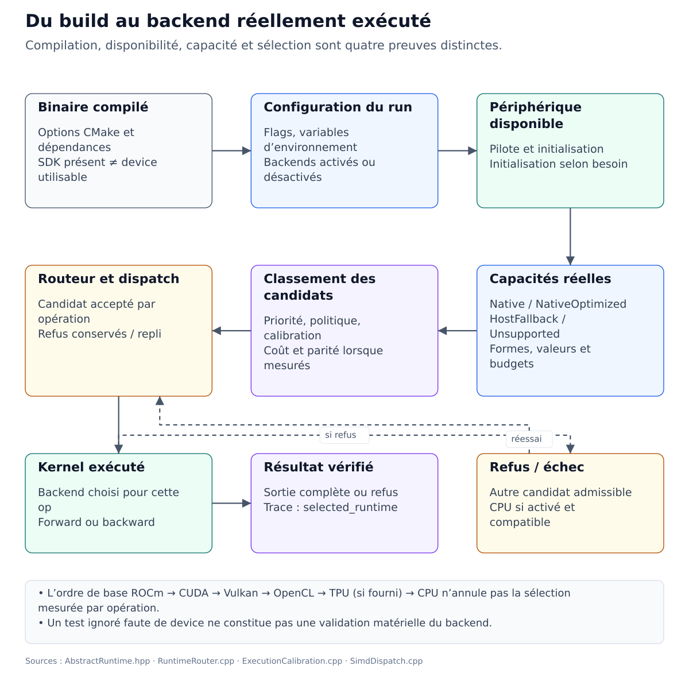
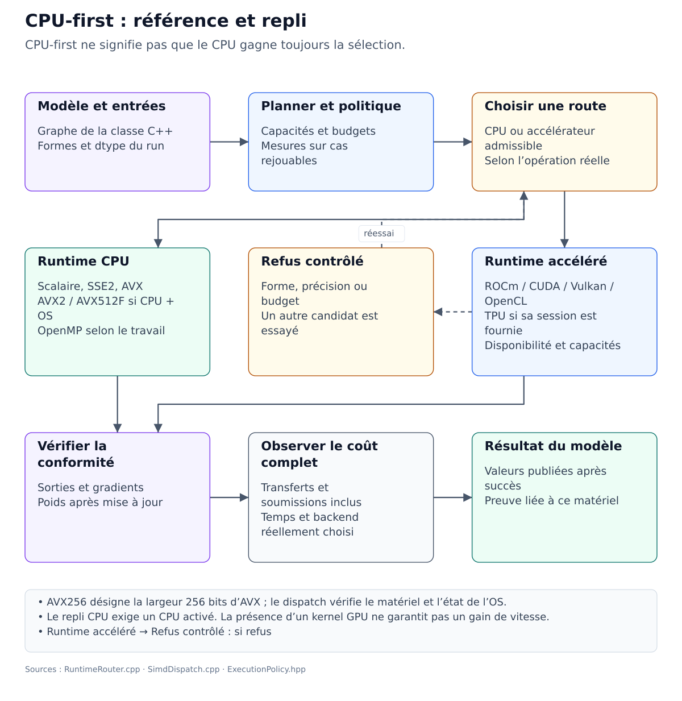

# Backends matériels

Comprendre le fonctionnement interne exact des composants runtime.

**Public concerné :** Développeur avancé qui modifie le moteur C/C++.

> **Prérequis**
>
> Connaître les bases C++ et la structure du dépôt.

## Sur cette page

- [Diagrammes d'explication](#diagrammes-dexplication)
- [Architecture générale](#architecture-générale)
- [RuntimeConfig — configuration commune](#runtimeconfig-configuration-commune)
- [Backend CUDA (cuBLAS)](#backend-cuda-cublas)
- [Backend ROCm (rocBLAS)](#backend-rocm-rocblas)
- [Backend CPU](#backend-cpu)
- [Backends Vulkan / OpenCL](#backends-vulkan-opencl)
- [TPU et services FPGA](#tpu-et-services-fpga)
- [Voir aussi](#voir-aussi)
- [Étapes suivantes](#étapes-suivantes)

## Diagrammes d'explication






Ce document décrit l'architecture interne du système de runtimes de Mímir : comment les layers sont dispatchés vers les différents backends matériels, comment `RuntimeConfig` est configuré, et comment chaque fast-path est implémenté en C++.

> **Public visé :** développeurs qui souhaitent comprendre ou modifier les runtimes. Si vous cherchez simplement à activer l'accélération GPU, lisez [le guide utilisateur GPU](../05-Advanced/05-GPU-Acceleration.md) à la place.

**Fichiers sources de référence :**

| Fichier | Rôle |
|---|---|
| `src/runtimes/AbstractRuntime.hpp` | Interface commune + struct `RuntimeConfig` |
| `src/runtimes/cpu/CpuRuntime.cpp` | Implémentation CPU (fallback universel) |
| `src/runtimes/cuda/CudaRuntime.cpp` | Fast-paths cuBLAS (CUDA) |
| `src/runtimes/rocm/RocmRuntime.cpp` | Fast-paths rocBLAS (ROCm/HIP) |
| `src/runtimes/vulkan/VulkanCompute.hpp` | Compute Vulkan (Linear, MatMul/BatchMatMul, Add/Multiply, ReLU/SiLU/GELU/Sigmoid/Tanh) |
| `src/runtimes/opencl/OpenCLCompute.hpp` | Chemins compute OpenCL spécialisés |
| `src/runtimes/portable/PortableRuntime.cpp` | Forward/backward de référence OpenCL et Vulkan |
| `src/runtimes/portable/PortableDevice.cpp` | Exécution des kernels via les API OpenCL et Vulkan |
| `CMakeLists.txt` | Flags de compilation : `ENABLE_CUDA`, `ENABLE_ROCM`, `ENABLE_VULKAN`, `ENABLE_OPENCL` |

---

## Architecture générale

### L'interface `AbstractRuntime`

Tous les backends implémentent la même interface C++ :

```cpp
class AbstractRuntime {
public:
    // Initialise le backend à partir de sa configuration (détectée via env vars)
    virtual bool initialize(const RuntimeConfig& cfg) = 0;

    // Tente d'exécuter un layer. Retourne false si ce layer n'est pas supporté
    // ou si les gardes refusent l'opération : RuntimeRouter essaie un autre candidat.
    virtual bool forwardLayer(
        const std::vector<const std::vector<float>*>& inputs,
        std::vector<std::vector<float>>& outputs,
        const Layer& layer,
        bool training) = 0;
};
```

`forwardLayer()` retourne `false` pour signaler "je ne peux pas gérer ce layer" — ce n'est pas une erreur, c'est le mécanisme de fallback.

La sélection des opérations dans les runtimes suit une convention explicite : **switch (`LayerType`)** dans `forwardLayer(...)` (pas de chaîne de `if` sur le type).

### Ordre de dispatch réellement exécuté

Le forward et le backward passent par `RuntimeRouter`. L'ordre de base fourni
par `setRuntimes(...)` est le suivant ; seuls les runtimes disponibles participent :

```
1. ROCm (si compilé, initialisé et activé)
2. CUDA (si compilé, initialisé et activé)
3. Vulkan (si compilé, initialisé et activé)
4. OpenCL (si compilé, initialisé et activé)
5. TPU (lorsqu'il est fourni au routeur)
6. CPU (repli lorsqu'il est activé)
```

Les capacités par type filtrent les routes, puis les capacités par opération
contrôlent formes, flags et limites numériques. `ExecutionCalibration` peut
reclasser les candidats natifs pour les opérations rejouables selon leur latence
mesurée. L'ordre de base ne garantit donc pas le backend exécuté. Un retour
`false` ou un résultat non fini permet un autre essai ; `selected_runtime` et
les traces identifient la route effectivement utilisée.

### Le pattern "do-while-false" dans les runtimes GPU

Chaque fast-path GPU dans `CudaRuntime::forwardLayer` / `RocmRuntime::forwardLayer` est encapsulé dans un bloc `do { ... } while(false)`. En cas d'échec (buffer device insuffisant, opération non supportée, etc.), le code fait `break` pour sortir proprement du bloc, puis retourne `false` :

```cpp
// Exemple simplifié du fast-path Linear
bool CudaRuntime::forwardLayer(...) {
    if (layer.type_enum == LayerType::Linear) {
        do {
            if (!config_.linear_enabled) break;
            if (compute_ops < config_.linear_min_ops) break;

            DeviceBuf d_input, d_weight, d_output;
            if (!d_input.alloc(...)) break;
            // ... appels cuBLAS ...
            cudaDeviceSynchronize();
            d_output.copyToHost(...);
            return true;  // succès
        } while (false);
        return false;  // le routeur essaie un autre candidat admissible
    }
    return false;
}
```

> **Note :** ce pattern est actif dans les runtimes GPU et fonctionne avec le dispatch du `RuntimeRouter`.

---

## `RuntimeConfig` — configuration commune

`RuntimeConfig` est la structure partagée par tous les runtimes GPU. Elle est peuplée une seule fois au démarrage via `RuntimeConfig::fromEnv(backend_upper)`, qui lit les variables d'environnement correspondant au backend.

```cpp
struct RuntimeConfig {
    bool disabled        = false;
    bool verbose         = false;
    int  device_index    = 0;

    bool linear_enabled  = false;
    int  linear_min_ops  = 0;  // ExecutionPolicy::automatic_minimum

    bool conv_enabled    = false;
    int  conv_min_ops    = 0;

    bool norm_enabled       = false;
    int  norm_min_elements  = 0;

    bool attention_enabled = false;
    int  attention_min_ops = 0;

    static RuntimeConfig fromEnv(const char* backend_upper);
    // Exemple : fromEnv("CUDA") lit MIMIR_CUDA_*, fromEnv("ROCM") lit MIMIR_ROCM_*
};
```

Cet extrait omet le champ `backend`. Les flags sont `false` dans une
configuration brute et dans `fromEnv()` sans variable correspondante.
L'initialisation par `Model` applique ensuite ses valeurs par défaut, dont
l'activation des familles CUDA/ROCm. Les minima de travail restent à zéro
par défaut ; les budgets de sécurité des kernels sont indépendants de ces minima.

### Variables d'environnement (CUDA — remplacer `CUDA` par `ROCM` pour AMD)

| Variable | Valeur | Effet |
|---|---|---|
| `MIMIR_DISABLE_CUDA` | `1` | Désactive complètement le runtime CUDA |
| `MIMIR_ACCEL_VERBOSE` | `1` | Log les décisions de dispatch (utile pour le diagnostic) |
| `MIMIR_CUDA_DEVICE` | entier | Index du GPU à utiliser (défaut : `0`) |
| `MIMIR_CUDA_LINEAR` | `1` | Active le fast-path `Linear` |
| `MIMIR_CUDA_LINEAR_MIN_OPS` | entier | Seuil MACs pour `Linear` (défaut runtime : `0`) |
| `MIMIR_CUDA_CONV` | `1` | Active le fast-path `Conv2d` |
| `MIMIR_CUDA_CONV_MIN_OPS` | entier | Seuil MACs pour `Conv2d` (défaut runtime : `0`) |
| `MIMIR_CUDA_NORM` | `1` | Active le fast-path `LayerNorm` / `RMSNorm` |
| `MIMIR_CUDA_NORM_MIN_ELEMS` | entier | Seuil éléments pour les norms (défaut runtime : `0`) |
| `MIMIR_CUDA_ATTENTION` | `1` | Active le fast-path `Attention` |
| `MIMIR_CUDA_ATTENTION_MIN_OPS` | entier | Seuil MACs pour Attention (défaut runtime : `0`) |

> **Portée effective aujourd'hui :** le dispatch principal passe par le `RuntimeRouter`; les fast-paths `LINEAR`/`CONV`/`NORM`/`ATTENTION` de CUDA/ROCm sont pris en compte quand activés.

---

## Backend CUDA (cuBLAS)

**Prérequis build :** `-DENABLE_CUDA=ON`. Dépendances CMake : `CUDA::cudart`, `CUDA::cublas`.

### Fast-path Linear (SGEMM)

Calcule `output[M,N] = input[M,K] × W[K,N]` via `cublasSgemm`, puis ajoute le biais via `cublasSaxpy`.

**Admissibilité :** `M × N × K ≥ linear_min_ops` (défaut `0`), puis validation
de la géométrie et sélection du runtime.

### Fast-path Conv2d (im2col + SGEMM)

Les convolutions ne sont pas directement supportées par cuBLAS, mais peuvent être réduites à une multiplication matricielle via la transformation **im2col**.

**Statut de dispatch :** implémenté dans `CudaRuntime::forwardLayer` et appelé via `RuntimeRouter`.

1. **Transfert vers GPU** de l'entrée CHW et des filtres.
2. **im2col sur le device** dans `CudaNativeOps.cuh`.
3. **SGEMM sur GPU** — `output = W_flat × col` via `cublasSgemm`.
4. **Biais via `cublasSger`**, si `use_bias` est activé.

Supporte : `stride`, `padding`, `dilation`.

Le chemin est admissible à l'entraînement. `CudaRuntime::backwardLayer`
appelle `CudaNativeOps::conv_backward` pour les gradients d'entrée, de poids et
de biais. La disponibilité déclarée doit être distinguée d'une exécution
réellement vérifiée sur matériel CUDA.

### Normalisations natives

`CudaNativeOps.cuh` fournit les calculs de LayerNorm/RMSNorm et
GroupNorm/InstanceNorm, y compris les réductions et leurs gradients sur device.
`CudaTrainingOps.cuh` couvre BatchNorm. La géométrie, les paramètres affines et
les flags sont contrôlés avant exécution.

**Statut de dispatch :** implémenté dans `CudaRuntime::forwardLayer` et appelé via `RuntimeRouter`.

Les copies d'entrée/sortie et l'accumulation finale des gradients dans les blocs
de paramètres du modèle restent du staging hôte.

### Fast-path Attention (multi-SGEMM)

Pour `SelfAttention`, `MultiHeadAttention` et `CrossAttention` :

`CudaAttentionOps.cuh` implémente projections, scores, masque causal, softmax,
contexte et gradients sur device. Les gardes de `CudaOperationGeometry.hpp`
déterminent les formes acceptées.

Pour `CrossAttention`, `Q` et `KV` proviennent de deux sources différentes (`qlen ≠ kvlen` est supporté).

**Statut de dispatch :** implémenté dans `CudaRuntime::forwardLayer` et appelé via `RuntimeRouter`.

### `DeviceBuf` — helper de buffer device

`DeviceBuf` est une RAII-wrapper autour d'un buffer CUDA. Il garantit que `cudaFree` est toujours appelé, même en cas d'exception :

```cpp
struct Impl::DeviceBuf {
    void*  ptr  = nullptr;
    size_t size = 0;

    bool alloc(size_t bytes);           // cudaMalloc
    bool copyFromHost(const void* src, size_t bytes);  // cudaMemcpy H→D
    bool copyToHost(void* dst, size_t bytes);           // cudaMemcpy D→H
    ~DeviceBuf();                       // cudaFree automatique
};
```

Les buffers de scratch persistants dans `Impl` réutilisent leur capacité sous
mutex. Une allocation n'est agrandie que si nécessaire ; cela ne dispense pas
de retransférer les poids modifiés. Les destructeurs libèrent les allocations
lorsque leurs propriétaires sont détruits.

---

## Backend ROCm (rocBLAS)

**Prérequis build :** `-DENABLE_ROCM=ON`. Dépendances CMake : `hip::host`, `roc::rocblas`.

ROCm partage plusieurs conventions d'implémentation avec CUDA et emploie les
correspondances API suivantes. Sa couverture native doit toutefois être
vérifiée indépendamment dans `RocmRuntime`, puis sur le matériel concerné :

| CUDA | ROCm/HIP |
|---|---|
| `cudaMalloc` / `cudaFree` | `hipMalloc` / `hipFree` |
| `cudaMemcpy` | `hipMemcpy` |
| `cudaDeviceSynchronize` | `hipDeviceSynchronize` |
| `cublasSgemm` | `rocblas_sgemm` |
| `cublasSger` | `rocblas_sger` |
| `cublasSdgmm` | `rocblas_sdgmm` |
| `cublasSaxpy` | `rocblas_saxpy` |

Le code est conditionnel via `#ifdef ENABLE_ROCM` / `#endif`. Les variables d'environnement utilisent le préfixe `MIMIR_ROCM_*`.

**Statut de dispatch :** les passes forward et backward passent par
`RuntimeRouter`. Les 18 primitives Primer, `CausalDepthwiseConv1d` et `SwiGLU`
restent déclarées `HostFallback` sur CUDA/ROCm ; leurs sources de génération
portables ne constituent pas une implémentation native de ces backends.

---

## Backend CPU

Le backend CPU est le fallback général lorsqu’il est activé. Il peut être désactivé par `MIMIR_DISABLE_CPU=1`, mais cette option n’est utile que pour diagnostiquer la couverture des autres runtimes : un graphe contenant une opération non couverte échouera alors au lieu de retomber sur CPU.

Les passes forward et backward passent par `RuntimeLayerDispatch`, qui délègue
aux kernels sous `src/runtimes/cpu/`. Les primitives Primer utilisent
`PrimerKernels.hpp` ; les types et métadonnées de couches restent dans
`LayerTypes.hpp` et `Layers.hpp`.

**Optimisations CPU disponibles :**

```cpp
bool Model::hasAVX2();  // Extensions vectorielles 256-bit
bool Model::hasFMA();   // Fusion multiply-add matérielle
bool Model::hasF16C();  // Conversion float16 native
bool Model::hasBMI2();  // Manipulation de bits avancée
```

Les kernels CPU utilisent **OpenMP** selon la charge si activé au build.
`RuntimeSimd` sélectionne scalaire, SSE2, AVX/256, AVX2 ou AVX512F pour les
primitives qui lui sont reliées. La détection CPUID/XGETBV vérifie CPU et OS ;
une extension détectée ne signifie pas que toute opération possède un kernel
spécifique à cette extension. Voir les [contrats SIMD](14-Layers-And-Ops.md#43-variantes-simd-cpu).

---

## Backends Vulkan / OpenCL

Ces backends sont exposés via runtimes dédiés (`VulkanRuntime` / `OpenCLRuntime`) et routés par `RuntimeRouter`.

Les backends Vulkan et OpenCL conservent leurs chemins spécialisés et utilisent
`PortableRuntime` pour les autres opérations et les passes arrière. Le registre
et les méthodes `queryForwardCapability` / `queryBackwardCapability` constituent
l'inventaire par type ; l'acceptation d'une opération réelle dépend ensuite de
ses entrées, dimensions, paramètres et limites de travail. `Lambda` est refusé
en forward par le dispatcher CPU lui-même ; son backward identité est supporté
sur CPU, Vulkan et OpenCL.

Les familles couvertes comprennent convolutions, normalisations, attention,
projections/embeddings, pooling, transformations de tenseurs, récurrence,
upsampling, dropout et reparamétrisation. Les convolutions ND,
`CausalDepthwiseConv1d`, `SwiGLU` et les 18
[primitives Primer](14-Layers-And-Ops.md#primitives-issues-de-létude-primer)
possèdent aussi des kernels forward et backward CPU et portables.

Les kernels portables indépendants par destination, dont ceux de Primer, sont
lancés en parallèle ; certains chemins de référence restent séquentiels.
Les réductions et rassemblements de gradients sont bornés avant lancement.
Cette couverture ne garantit pas des performances supérieures au CPU. Le
staging des tenseurs et l'accumulation des gradients de paramètres retournés
restent sur l'hôte ; un calcul natif déclaré n'utilise pas un calcul de référence
CPU caché.

Pour Primer, les entrées et gradients FP32 subnormaux sont refusés sur le chemin
portable. Les kernels signalent également un zéro calculé ambigu pouvant cacher
un sous-flux ; le routeur peut alors réessayer sur CPU sans publier le résultat
GPU. Le refus est conservateur et peut aussi concerner une annulation exacte.
Les domaines singuliers et les résultats non finis restent refusés sur CPU.

| Backend | Build flag | Couverture native par type | Variables |
|---|---|---|---|
| Vulkan | `ENABLE_VULKAN` | Chemins spécialisés et kernels `PortableRuntime`, dont Primer forward/backward | `MIMIR_VULKAN_LINEAR_SPV`, `MIMIR_VULKAN_LINEAR`, `MIMIR_VULKAN_CONV` |
| OpenCL | `ENABLE_OPENCL` | Chemins spécialisés et kernels `PortableRuntime`, dont Primer forward/backward | `MIMIR_OPENCL_LINEAR` |

`Unsupported`, `HostFallback`, `Native` et `NativeOptimized` désignent des
niveaux de capacité distincts. Pour l'inventaire actuel du binaire :

```bash
./bin/mimir --lua scripts/tools/inspect_architectures.lua -- --runtime
```

Cet inventaire déclare les capacités ; les traces et les tests avec
`selected_runtime` prouvent le backend réellement exécuté. Le routeur propose
au backend suivant toute opération refusée ou en échec.

`RuntimeTest.VulkanPrimerOps` vérifie les valeurs, gradients et replis numériques
avec contrôle du runtime sélectionné. L'existence des sources OpenCL et leur
validation syntaxique ne remplacent pas une exécution de ces opérations sur un
périphérique OpenCL.

---

## TPU et services FPGA

`TpuRuntime` utilise un worker Python JAX/XLA. Son initialisation dépend du
worker et de ses dépendances ; une exécution JAX sur CPU ne prouve pas un calcul
sur TPU. Le routeur accepte ce runtime entre OpenCL et CPU lorsqu'il lui est fourni.

Les sources `FpgaRuntime.cpp`, `FpgaSession.cpp` et `FpgaIo.cpp` sont incluses
dans `MIMIR_SOURCES`. Le service FPGA détecte la carte et négocie son firmware
pour le buffering de dataset, les conversions F32/F16/BF16 et le contrôle
d'intégrité des checkpoints. `MIMIR_DISABLE_FPGA=1` le désactive.
`FpgaRuntime::forwardLayer`, `linearForward` et les votes de types retournent
`false` : il ne constitue pas une route de calcul neuronal dans le routeur.
La détection ou le handshake ne démontre donc pas une accélération de layers.
Voir [l'étude FPGA et son état d'intégration](../05-Advanced/06-FPGA-iCESugar-Pro-Runtime-Study.md).

## Voir aussi

- [Guide utilisateur GPU](../05-Advanced/05-GPU-Acceleration.md) — activer et configurer l'accélération
- [GPU Runtimes — internals](./21-GPU-Runtimes.md) — guide pour étendre les runtimes
- [Planning](./22-Planning.md) — analyse statique du graphe, fusions et scratchpads

## Étapes suivantes

- [Page précédente : Internals - mémoire](02-Memory.md)
- [Index de la documentation](../00-INDEX.md)
- [Page suivante : Internals: Monitoring (HtopDisplay / Visualizer / AsyncMonitor)](04-Monitoring-Htop-Visualizer.md)
