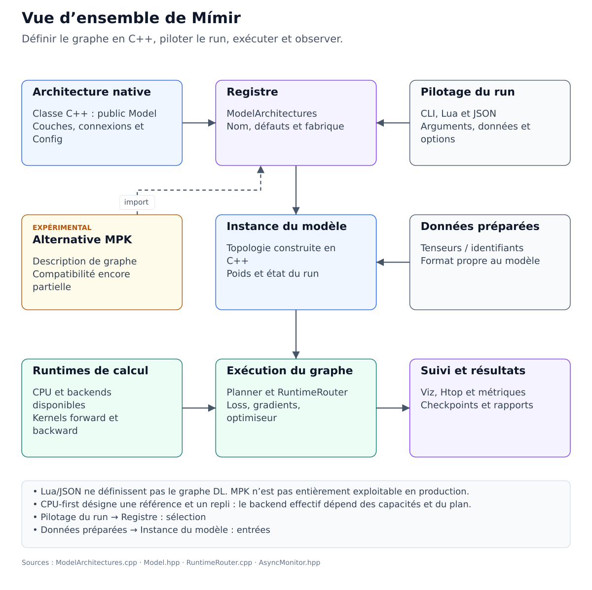

# Parcours complet du framework

Ce parcours couvre les principaux aspects de Mímir, du lancement d'un modèle
natif à la contribution au moteur. Il sert de carte de travail : chaque thème
renvoie à un atelier progressif, avec un résultat concret et ses prérequis.

## Poser les responsabilités

Le graphe DL doit être défini en C/C++ dans une **classe héritant de `Model`**.
La configuration et l'exécution appartiennent à Lua, JSON et aux autres bridges.
Le seul autre moyen de décrire une architecture est **MPK**, encore expérimental
et pas encore entièrement exploitable en production. Le chargement d'un package
ne démontre pas l'équivalence de sa reconstruction avec un modèle natif.

Lisez le [contrat des architectures](../07-Devs/08-Architecture-Contract.md)
avant de commencer un modèle ou de convertir une structure existante.

## Choisir la profondeur de travail

| Niveau | Travail attendu | Validation |
| --- | --- | --- |
| Débutant | Exécuter une commande, reconnaître modèle/config/données | Un résultat et un log expliqués |
| Autonome | Changer un paramètre, sauvegarder et reproduire un run | Même configuration et résultat de référence |
| Avancé | Adapter un workflow, évaluer et diagnostiquer | Mesures et checkpoint cohérents |
| Expert | Ajouter une classe modèle, une opération ou un backend | Tests numériques, intégration et limites explicites |

Vous n'avez pas besoin d'un GPU, d'un corpus externe ou d'une interface graphique
pour les premières étapes. Chaque atelier indique quand ces ressources deviennent
nécessaires.

## Couvrir les domaines dans l'ordre

| Étape | Domaine | Atelier et résultat |
| --- | --- | --- |
| 1 | Installation, CLI et configuration | [Installation et configuration](10-Tuto-Installation-Configuration.md) : binaire utilisable et profil de lancement explicite |
| 2 | Contrat du modèle, registre, lifecycle | [Le framework en trois étapes](01-Cours-Framework-3-Etapes.md) et [du registre au checkpoint](08-Tuto-Registre-Pipeline-Checkpoint.md) : instance native et sauvegarde lisible |
| 3 | Données, modalités, annotations et BPE | [Données et tokenizer](11-Tuto-Donnees-Tokenizer.md) : entrées conformes et tokenizer compatible avec les checkpoints |
| 4 | Entraînement, validation, reprise et inférence | [Cycle de travail complet](12-Tuto-Entrainement-Validation-Reprise-Inference.md) : run court, évaluation et continuation contrôlée |
| 5 | MLP, vision, texte et diffusion | [Familles de modèles](13-Tuto-Familles-De-Modeles.md) : bon script et bon objectif pour une architecture donnée |
| 6 | Viz, Htop, rapports et projection 3D | [Métriques et diagnostic](14-Tuto-Viz-Metriques-Diagnostic.md) : métriques identifiées et captures interprétées |
| 7 | Mémoire, runtime, planner et performance | [Mémoire et performance](15-Tuto-Memoire-Performances-Runtimes.md) : mesure CPU de référence et comparaison attribuée au backend réel |
| 8 | Build, portabilité, AMP et DDP | [Compilation et distribution](16-Tuto-Compilation-Portabilite-AMP-DDP.md) : options compilées et options de run distinguées |
| 9 | Scripts, exports, tests et contribution | [Workflow de développement](17-Tuto-Scripting-Exports-Tests-Contribution.md) : artefact vérifié et validation reproductible |
| 10 | Architectures C++ | [Ajouter un modèle](02-Tuto-Ajouter-Modele.md) : classe dérivée de `Model`, factory et test |
| 11 | Layers, autograd et noyaux | [Ajouter une opération](05-Tuto-Ajouter-Op.md) : contrat de formes, calculs runtime et gradients vérifiés |
| 12 | Backends et routage | [Ajouter ou modifier un runtime](04-Tuto-Modifier-Ou-Ajouter-Runtime.md) : choix du backend et repli explicites |
| Option | Packages d'architecture expérimentaux | [Créer un MPK](09-Tuto-Creer-MPK.md) : spécification inspectée, avec limites de reconstruction documentées |

## Atelier de départ sans dataset

Réalisez le [tutoriel registre vers checkpoint](08-Tuto-Registre-Pipeline-Checkpoint.md)
avec `basic_mlp`, puis le [test du VAE convolutionnel](07-Tuto-VAEConv-Sans-Dataset.md).
Ces deux exercices permettent de comprendre allocation, poids, sauvegarde et
vérifications ciblées avant d'ajouter des données réelles.

Consignez quatre observations : le nom de la classe native, la configuration
utilisée, le nombre de paramètres et le résultat vérifié par le test. La présence
d'un nom dans le registre ou d'une courbe dans Viz ne démontre pas à elle seule
la qualité du modèle.

## Passer à un workflow réel

Choisissez une seule famille de modèle et son script spécialisé. Vérifiez :

1. le format et les prérequis des données ;
2. la correspondance entre entrées, cibles et objectif ;
3. la provenance du tokenizer et des éventuels sous-modèles gelés ;
4. la séparation apprentissage/validation ;
5. la sauvegarde des métadonnées et de l'état optimiseur ;
6. le chargement en inférence avec la même topologie.

Le guide des [modèles disponibles](../03-API-Reference/11-Architectures.md)
et l'[état du projet](../00-PROJECT-STATUS.md) distinguent les chemins utilisables,
partiels, expérimentaux et placeholders. Les composants T5, SD3.5, MPK ou FPGA
ne doivent pas être supposés équivalents à un pipeline complet.

## Étendre le framework

Une nouvelle architecture reste une classe dérivée de `Model`. Un nouveau layer
reste un type de couche dont le calcul vit dans les runtimes. L'orchestration du
modèle ne doit pas réimplémenter les kernels dans ses méthodes de description.

Après chaque modification, choisissez le test qui correspond au comportement
changé. Contrôlez les sorties et les gradients avant de mesurer une vitesse.
Une preuve CPU, une compilation CUDA et une exécution GPU sont trois niveaux
différents. Les tutoriels avancés indiquent leurs limites de validation.

## En cas de blocage

| Problème | Première piste |
| --- | --- |
| Binaire ou dépendance introuvable | Installation, profil de build, répertoire courant |
| API ou option inconnue | Aide du script et référence correspondant au checkout |
| Formes incohérentes | Métadonnées de la classe, noms des tenseurs et format des données |
| Checkpoint incompatible | Topologie, tokenizer, état optimiseur et options de reprise |
| GPU lent ou non sélectionné | Trace du routeur, capacités par opération et temps de transfert |
| MPK partiellement appliqué | Limites expérimentales et comparaison au graphe natif |

## Étapes suivantes

- [Catalogue des tutoriels](00-INDEX.md)
- [Parcours par niveau](../01-Getting-Started/06-Learning-Paths.md)
- [Guide développeur](../07-Devs/00-INDEX.md)
